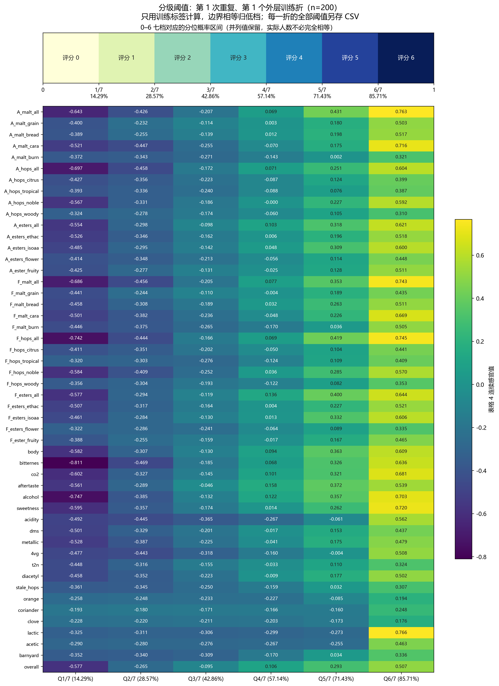
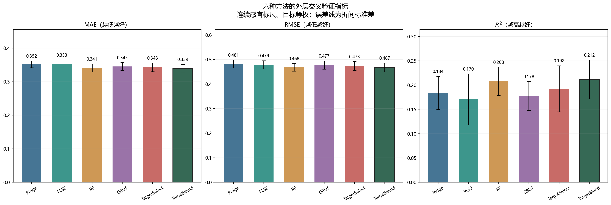
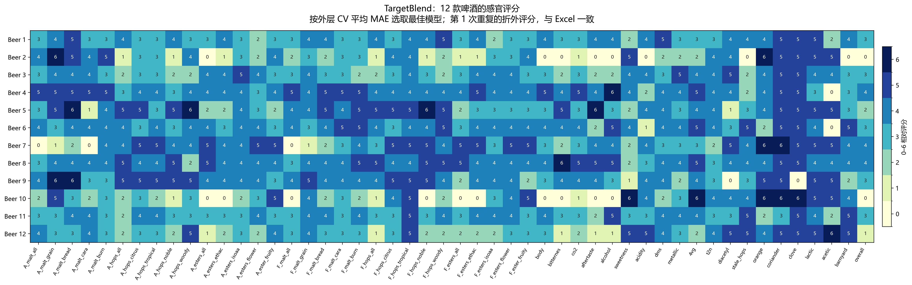

# 问题一：基于逐指标收缩融合的啤酒感官预测与相对评分

## 1 问题分析与建模目标

问题一要求根据啤酒的化合物及理化指标预测感官特征，并形成可用于评分卡展示的感官评分。现有数据包含 250 款啤酒、231 个化学特征和 50 个连续感官指标。其中，香气指标（Aroma）与风味指标（Flavour）各 15 个，其余感官指标共 20 个。输入维数与样本量接近，直接使用缺少约束的回归模型容易受到特征相关性和极端观测的影响；同时，不同感官指标未必适合使用同一种预测方法。

已有研究将化学测量与感官数据结合，用机器学习预测啤酒风味，为本问题提供了方法参考[1]。本文设置岭回归（Ridge）、多响应偏最小二乘回归（PLS2）、随机森林（RF）和梯度提升回归树（GBDT）四种基模型，并在此基础上构建逐指标模型选择策略 TargetSelect 和逐指标收缩融合策略 TargetBlend。四种基模型分别提供正则化线性预测、共享潜变量预测以及两类树模型预测，融合方法则允许每个感官指标使用不同的模型组合。

记化学特征矩阵和感官标签矩阵为

$$
\mathbf X=(x_{i\ell})\in\mathbb R^{250\times231},
\qquad
\mathbf Y=(y_{ij})\in\mathbb R^{250\times50},
$$

其中，\(i\) 表示啤酒样本，\(\ell\) 表示化学特征，\(j\) 表示感官指标。对每个指标建立预测函数

$$
\widehat y_{ij}=f_j(\mathbf x_i),\qquad j=1,\ldots,50.
\tag{1}
$$

建模分为连续预测和相对分级两个阶段：首先在附件给定的连续感官标尺上训练、比较模型；随后依据训练标签的分位数，将连续预测转换为 0–6 级。由于现有标签缺少恢复原始评分所需的标定信息，本文输出的整数为**训练分布下的相对等级**，不将其解释为原始人工评分的反标准化结果。

## 2 数据对齐与训练折内预处理

### 2.1 样本与字段对齐

以 beer 编号为主键，对化学特征表和专业感官表进行一一匹配，检查编号是否存在缺失、重复及样本集合不一致，并核对风格等样本信息。beer、beer_id 和 tasting_category_fine 仅用于对齐与结果说明，不作为预测特征。

化学输入使用保留原始缺失位置的结构整理副本，已填补标准化数据表仅用于确定 231 个化学字段及其顺序。该处理避免直接把历史预处理过程中拟合的填补、缩放参数带入新的交叉验证。对齐后保留全部 250 个样本，化学输入共含 73 个缺失单元格；50 个感官标签均为有限连续值。对数变换等数据表示可能产生合法负数，因此不按正负号删除观测，也不把零值统一视为缺失。

### 2.2 中位数填补与分位数缩尾

设某一训练折的样本集合为 \(\mathcal T\)。对第 \(\ell\) 个化学特征，仅使用该训练折的已观测值计算中位数 \(m_\ell^{(\mathcal T)}\)，并进行缺失填补：

$$
\widetilde x_{i\ell}=
\begin{cases}
x_{i\ell}, & x_{i\ell}\text{ 已观测},\\
m_\ell^{(\mathcal T)}, & x_{i\ell}\text{ 缺失}.
\end{cases}
\tag{2}
$$

为限制极端输入对模型拟合的影响，对填补后的训练特征计算 1% 和 99% 分位点 \(a_\ell^{(\mathcal T)}\)、\(b_\ell^{(\mathcal T)}\)，实施缩尾：

$$
x_{i\ell}^{c}
=\min\!\left\{
b_\ell^{(\mathcal T)},
\max\!\left[a_\ell^{(\mathcal T)},\widetilde x_{i\ell}\right]
\right\}.
\tag{3}
$$

验证样本沿用训练折计算的中位数和缩尾边界，不重新估计参数。缩尾保留样本及字段，仅限制边界外的输入数值，不等同于删除样本。1% 的缩尾比例是程序预先设置的参数，本次结果不能单独证明该比例优于其他取值。

### 2.3 特征与标签标准化

对缩尾后的化学特征进行训练折内标准化：

$$
u_{i\ell}
=\frac{x_{i\ell}^{c}-\mu_\ell^{(\mathcal T)}}
{s_\ell^{(\mathcal T)}}.
\tag{4}
$$

各感官目标在模型拟合前也按当前训练折进行标准化：

$$
z_{ij}
=\frac{y_{ij}-\overline y_j^{(\mathcal T)}}
{s_{y,j}^{(\mathcal T)}}.
\tag{5}
$$

标准差采用总体标准差；零方差字段按实现保留，以尺度 1 进行处理。模型预测后，使用相同训练折的标签参数恢复至附件给定的连续感官标尺：

$$
\widehat y_{ij}
=\overline y_j^{(\mathcal T)}
+s_{y,j}^{(\mathcal T)}\widehat z_{ij}.
\tag{6}
$$

式（6）仅撤销本轮训练内部增加的标准化，不恢复附件形成之前的原始人工评分。缺失填补、缩尾、特征缩放和标签缩放均在各训练折内部拟合，验证标签不参与这些参数的计算。

## 3 四种基预测模型

### 3.1 岭回归

岭回归通过二次惩罚约束回归系数，用作高维输入下的正则化线性参照[2]。对第 \(j\) 个标准化感官指标，求解

$$
\min_{\boldsymbol\beta_j,b_j}
\sum_{i\in\mathcal T}
\left(z_{ij}-b_j-\mathbf u_i^\mathsf T\boldsymbol\beta_j\right)^2
+\alpha_j\|\boldsymbol\beta_j\|_2^2.
\tag{7}
$$

其中，\(\alpha_j\) 控制系数收缩强度。虽然程序调用多输出回归接口，不同目标仍可分别选择各自的正则化参数，截距不受二次惩罚。

### 3.2 多响应偏最小二乘回归

PLS2 在化学特征与多个感官目标之间构建共享潜变量，用于刻画输入和输出的共同变化结构[3]。其回归表示可写为

$$
\mathbf U\approx\mathbf T\mathbf P^\mathsf T,
\qquad
\mathbf Z\approx\mathbf T\mathbf C^\mathsf T,
\tag{8}
$$

其中，\(\mathbf T\) 为低维得分矩阵，\(\mathbf P\)、\(\mathbf C\) 为相应载荷矩阵。潜变量数量控制模型复杂度。本实现对全部感官目标联合拟合 PLS2，各目标共享同一潜变量数，不为每个目标另建一个独立的 PLS2 模型。

### 3.3 随机森林与梯度提升回归树

随机森林利用多棵随机化回归树的平均预测描述特征与感官指标之间的非线性关系[4]：

$$
\widehat z_j^{\mathrm{RF}}(\mathbf u)
=\frac{1}{B}\sum_{b=1}^{B}h_{jb}(\mathbf u).
\tag{9}
$$

GBDT 则在平方损失下逐步加入回归树，修正已有模型的预测误差[5]：

$$
\widehat z_j^{\mathrm{GBDT}}(\mathbf u)
=h_{j0}+\eta\sum_{t=1}^{B}h_{jt}(\mathbf u),
\tag{10}
$$

其中，\(B\) 为树的数量，\(\eta\) 为学习率。两种树模型均逐目标拟合和选择参数，允许不同感官指标使用不同的树结构约束。

**表 1 基模型的标准模式候选参数**

| 方法 | 内层验证选择的参数 | 其余主要设置 |
|---|---|---|
| Ridge | \(\alpha_j\in\{0.1,1,10,100,1000,10000\}\) | SVD 求解；逐目标选参 |
| PLS2 | 潜变量数 \(L\in\{2,5,10,15\}\) | 联合多输出；最大迭代次数 1000 |
| RF | 最小叶节点样本数 \(\{2,5\}\)；候选特征比例 \(\{0.5,0.8\}\) | 150 棵树；不预设最大深度 |
| GBDT | 最大深度 \(\{1,2\}\) | 150 棵树；学习率 0.05；最小叶节点样本数 5；平方损失 |

表 1 对应代码未启用快速检查模式时的搜索范围，候选参数只使用内层验证成绩选择，不根据外层结果逐次修改。

## 4 逐指标模型选择与收缩融合

### 4.1 构造训练内部折外预测

为学习模型权重，对外层训练集进一步执行内层交叉验证。每个基模型先在相同的内层划分上选择参数，再重组所选参数对应的折外预测。程序默认进行 3 次内层重复；同一样本在每次重复中恰好取得一次验证预测，再将这些重复预测取平均。

记第 \(m\) 个基模型对训练样本 \(i\)、目标 \(j\) 的平均折外预测为

$$
p_{ijm}
=\frac{1}{R_{\mathrm{in}}}
\sum_{r=1}^{R_{\mathrm{in}}}
\widehat y_{ijm}^{\,\mathrm{OOF},r},
\qquad R_{\mathrm{in}}=3.
\tag{11}
$$

模型顺序固定为 Ridge、PLS2、RF、GBDT。每个 \(p_{ijm}\) 均来源于没有包含该样本的内层训练子集，但其候选参数已利用内层验证结果选择。因此，这批内层预测用于参数选择和融合训练，其误差属于训练诊断，不作为最终泛化成绩。

### 4.2 TargetSelect：为每个感官指标选择一个模型

以平均绝对误差为选择准则，分别确定每个目标的最佳基模型：

$$
m_j^*
=\underset{m\in\{1,2,3,4\}}{\arg\min}
\frac{1}{|\mathcal T|}
\sum_{i\in\mathcal T}|y_{ij}-p_{ijm}|.
\tag{12}
$$

TargetSelect 对外层验证样本采用

$$
\widehat y_{ij}^{\mathrm{Select}}
=\widehat y_{ij,m_j^*}.
\tag{13}
$$

这一策略允许香气、风味等不同目标由不同基模型负责。若误差相同，则按预先固定的模型顺序决胜。训练均值和中位数仅作为程序中的诊断参照，不加入本章六种方法的候选集合。

### 4.3 TargetBlend：向最佳单模型收缩的加权融合

TargetSelect 仅保留一个模型，可能舍弃其他模型的补充信息。为此，TargetBlend 为每个目标设置独立权重向量

$$
\mathbf w_j=(w_{j1},w_{j2},w_{j3},w_{j4})^\mathsf T,
\qquad
w_{jm}\geq0,\quad\sum_{m=1}^{4}w_{jm}=1,
\tag{14}
$$

并按下式进行连续值融合：

$$
\widehat y_{ij}^{\mathrm{Blend}}
=\sum_{m=1}^{4}w_{jm}\widehat y_{ijm}.
\tag{15}
$$

记 \(\mathbf e_j\) 为 TargetSelect 所选模型对应的单位向量。为抑制小样本下过于不稳定的权重组合，求解

$$
\begin{aligned}
\min_{\mathbf w_j}\quad&
\frac{1}{|\mathcal T|}
\sum_{i\in\mathcal T}
\left(
\frac{\sum_{m=1}^{4}w_{jm}p_{ijm}-y_{ij}}
{s_j}
\right)^2
+\lambda\|\mathbf w_j-\mathbf e_j\|_2^2,\\
\text{s.t.}\quad&
w_{jm}\geq0,\qquad
\sum_{m=1}^{4}w_{jm}=1.
\end{aligned}
\tag{16}
$$

其中，\(s_j\) 为外层训练标签中第 \(j\) 个目标的标准差；对近常量目标，计算中以 1 替代过小尺度。收缩系数预先设为 \(\lambda=0.05\)，不依据外层验证成绩选择。

式（16）的第一项控制标准化平方误差，第二项限制融合权重偏离内层最佳单模型的程度。该惩罚的参照是最佳单模型的单位向量，而非四个模型的等权向量。模型之间的互补程度不同，因而各感官指标可以取得不同的融合权重。

程序采用序列最小二乘规划法（SLSQP）求解式（16），以 \(\mathbf e_j\) 为初始可行解，最多迭代 300 次。若求解未收敛、权重违反约束，或求得的正则化目标值劣于初始解，则回退至 TargetSelect，并记录原因。融合不设置额外截距，也不将不同感官目标混合为一个分数。

## 5 嵌套交叉验证与求解过程

采用外层五折交叉验证比较六种方法。将 250 个样本随机打乱后分为五折，每次以 200 个样本为外层训练集、50 个样本为外层验证集，初始随机种子为 42。内层采用三折交叉验证并重复三次。六种方法共用相同的内外层划分及随机种子计划，避免因划分不同造成额外的比较偏差。

每个外层折按以下顺序执行：

1. 仅使用外层训练样本建立内层划分；在每个内层训练子集中拟合填补、缩尾和缩放参数。
2. 在相同内层验证折上比较各基模型候选参数。Ridge、RF、GBDT 逐目标选参，PLS2 选择共享潜变量数。
3. 重组所选候选参数的内层折外预测，得到式（11），据此确定 TargetSelect 的选择和 TargetBlend 的权重。
4. 使用完整外层训练集重新拟合预处理与已选参数的基模型，再对外层验证样本生成预测。
5. 用已固定的选择或权重生成两种融合预测，计算外层连续值评价指标。
6. 仅根据该外层训练集的感官标签计算分级阈值，将连续预测转为相对等级，并保存预测、参数、权重与样本划分记录。

外层验证标签不参与该折的预处理、基模型调参或融合定权。程序随后以所有外层折的平均 MAE 选择最终报告的方法；若并列，再依次比较平均 RMSE、平均 \(R^2\) 和固定模型顺序。

本实验使用全部 250 款啤酒进行外层交叉验证，展示的 Beer 1–Beer 12 是其中 12 个样本的折外预测。每款啤酒未参与生成自身外层预测时的模型拟合和权重学习，但这 12 款并未作为一个整体始终排除在训练之外。因此，本章评价的是同类数据分布下的交叉验证表现，不将其称为 12 款独立外部样本的预测检验，也不解释为未知啤酒风格的外推能力。

## 6 基于训练分位数的 0–6 相对等级

对外层训练集中的每个感官指标独立计算六个经验分位点：

$$
q_{jk}^{(\mathcal T)}
=Q_{k/7}\bigl(\{y_{ij}:i\in\mathcal T\}\bigr),
\qquad k=1,\ldots,6,
\tag{17}
$$

其中，经验分位数采用线性插值。六个分位概率依次约为 14.29%、28.57%、42.86%、57.14%、71.43% 和 85.71%。对应相对等级定义为

$$
\widehat g_{ij}
=\sum_{k=1}^{6}
\mathbb I\!\left(\widehat y_{ij}>q_{jk}^{(\mathcal T)}\right),
\qquad \widehat g_{ij}\in\{0,1,\ldots,6\}.
\tag{18}
$$

因此，\((-\infty,q_{j1}]\) 对应 0 级，\((q_{j1},q_{j2}]\) 对应 1 级，依此类推，\((q_{j6},+\infty)\) 对应 6 级。连续预测恰好等于阈值时归入较低等级。重复分位点保留原值，不加入扰动，所以并列值会落入同一档，实际七档人数不一定相等，部分档位也可能为空。

**图 1 训练标签分位数及 0–6 相对等级阈值。** 上图给出七档对应的分位概率区间，下图给出第 1 次重复、第 1 个外层训练折的 50 个指标阈值，训练样本数为 200。颜色和标注对应附件给定连续感官标尺上的数值；其他外层折使用各自训练标签计算的阈值。

以图 1 中的 A_malt_all 为例，六个阈值按图示精度依次约为

$$
(-0.643,\,-0.426,\,-0.207,\,0.069,\,0.431,\,0.763).
$$

若某款验证啤酒在该指标上的连续预测为 0.20，则该值高于前四个阈值、低于第五个阈值，对应相对等级为 4。不同指标的标签分布不同，因此必须分别计算阈值，不能对全部感官指标采用同一组连续值分界点。

图 1 还显示，一些细分指标的多个分位点集中于较窄的数值区间。这意味着相近的连续预测也可能跨越相邻等级，整数档位需要结合连续预测理解。分位数分级描述的是训练分布中的相对位置，不提供感官强度与原始人工评分之间的物理标定。

## 7 评价指标

在每个外层验证折内，先分别评价 50 个感官指标，再对各指标等权平均。设第 \(k\) 个验证折有 \(n_k\) 个样本，第 \(j\) 个目标的误差为 \(e_{ij}=y_{ij}-\widehat y_{ij}\)，则

$$
\mathrm{MAE}_{j,k}
=\frac{1}{n_k}\sum_{i\in\mathcal V_k}|e_{ij}|,
\qquad
\mathrm{RMSE}_{j,k}
=\sqrt{\frac{1}{n_k}\sum_{i\in\mathcal V_k}e_{ij}^{2}},
\tag{19}
$$

$$
R_{j,k}^{2}
=1-
\frac{\sum_{i\in\mathcal V_k}e_{ij}^{2}}
{\sum_{i\in\mathcal V_k}(y_{ij}-\overline y_{j,\mathcal V_k})^{2}}.
\tag{20}
$$

宏平均 MAE 和 RMSE 分别为

$$
\mathrm{MAE}_{k}
=\frac{1}{50}\sum_{j=1}^{50}\mathrm{MAE}_{j,k},
\qquad
\mathrm{RMSE}_{k}
=\frac{1}{50}\sum_{j=1}^{50}\mathrm{RMSE}_{j,k}.
\tag{21}
$$

宏平均 \(R^2\) 仅对该验证折内真实标签方差非零的指标取平均。负 \(R^2\) 保留，不截断为零。式（21）的 RMSE 是“先逐指标开方、再平均”，与将全部误差合并后一次开方的 pooled RMSE 不同，结果表及柱状图均采用前者。

最后，对五个外层折的宏平均指标计算均值及折间样本标准差。柱状图误差线描述外层折之间的波动，不是置信区间，也不能单凭误差线是否重叠判定模型间差异是否具有统计显著性。

## 8 实验结果与分析

### 8.1 六种方法的连续预测性能

**表 2 六种方法的外层交叉验证平均结果**

| 方法 | MAE（越低越好） | 宏平均 RMSE（越低越好） | 宏平均 \(R^2\)（越高越好） |
|---|---:|---:|---:|
| Ridge | 0.3516 ± 0.0100 | 0.4815 ± 0.0165 | 0.1839 ± 0.0340 |
| PLS2 | 0.3529 ± 0.0118 | 0.4787 ± 0.0166 | 0.1705 ± 0.0527 |
| RF | 0.3407 ± 0.0119 | 0.4677 ± 0.0157 | 0.2079 ± 0.0290 |
| GBDT | 0.3451 ± 0.0118 | 0.4771 ± 0.0168 | 0.1777 ± 0.0298 |
| TargetSelect | 0.3428 ± 0.0131 | 0.4731 ± 0.0183 | 0.1924 ± 0.0475 |
| **TargetBlend** | **0.3390 ± 0.0126** | **0.4674 ± 0.0178** | **0.2117 ± 0.0400** |

注：数值来自同次完整运行的 cv_summary.csv，按“外层折均值 ± 折间样本标准差”列示，保留四位小数。标准差不是置信区间。

**图 2 六种方法的外层交叉验证性能比较。** 三个子图依次为连续感官标尺上的宏平均 MAE、宏平均 RMSE 与宏平均 \(R^2\)，误差线为外层折间标准差，黑色边框标出按平均 MAE 选出的报告方法。

四种基模型中，RF 的 MAE 和 RMSE 分别为 0.3407、0.4677，宏平均 \(R^2\) 为 0.2079，数值表现优于其余三个基模型。Ridge 和 PLS2 的 MAE 接近，说明在本次设置下，两种线性建模方式均未达到 RF 的平均误差水平；该结果不能单独证明所有感官指标都具有非线性关系。

TargetSelect 的 MAE 为 0.3428，略高于 RF 的 0.3407。逐目标选取内层获胜模型并未自动转化为更好的外层表现，提示小样本下单一获胜模型的选择会受到训练划分与估计误差的影响。

TargetBlend 在本轮比较的三个平均指标上均取得数值最优，故按预先规定的 MAE 标准将其选为报告方法。使用 CSV 中未四舍五入的数值计算，相对 RF，其 MAE 降低约 0.48%，RMSE 降低约 0.07%，宏平均 \(R^2\) 增加约 0.0038；相对 TargetSelect，MAE 降低约 1.10%。这些结果与“保留多个模型的补充信息可能改善硬选择”的建模动机一致，但尚不能将改进归因于某一个具体模型权重或收缩项，因为未提供对应消融实验。

上述提升幅度较小，不能据此声称融合显著优于全部基模型。宏平均 \(R^2\) 约为 0.212，也表明跨目标平均拟合能力仍有限；它不是将全部感官标签合并后得到的决定系数，不能直接表述为“解释全部感官总方差的 21.2%”。

### 8.2 12 款啤酒的折外相对评分

对按外层平均 MAE 选出的 TargetBlend，提取第 1 次外层交叉验证中 Beer 1–Beer 12 的折外连续预测，并使用各自对应外层训练折的阈值进行分级。评分字段按评分卡 summary 表头映射与排序，统一处理字段别名，避免依赖化学表或感官表的原有列位置。

**图 3 TargetBlend 对 12 款啤酒的折外相对评分。** 行对应 Beer 1–Beer 12，列对应评分卡中的 50 个感官指标，单元格数字与颜色表示 0–6 相对等级。该图与评分工作簿使用同一份折外预测及阈值，等级相等边界归低档。

从图 3 可见，12 款啤酒的预测感官轮廓并不相同。例如，Beer 2 与 Beer 10 在酒体、苦味和酒精相关维度上的相对档位较低，而甜味档位较高；Beer 5 与 Beer 8 的部分酒花相关维度处于较高档位。这些差异可用于描述预测感官轮廓，不直接构成整体品质排序，也不能解释为已经获得独立感官实验确认的差异。

各行可能来自不同外层验证折，因此对应的训练分位阈值并不完全相同。相同档位表示在各自参考训练分布中处于相近的相对区间，不保证原始连续强度完全相等。若后续需要对真正未标注的 12 款目标进行统一标尺评分，应将其整体隔离，以固定的非目标训练集重新拟合模型和共同分级阈值；本次折外评分不能替代这一独立预测过程。

## 9 模型评价与适用范围

本方法在同一组外层划分下比较四个基模型和两种逐指标组合策略，能够核查改进是否来自完整预测流程，而非不同数据划分。融合权重针对每个感官目标独立求解，并受到非负、和为 1 及向最佳单模型收缩的约束，便于检查各目标的模型构成。预处理与相对分级均只使用对应训练折的信息，避免直接利用验证标签估计填补、缩放或分级参数。

现有结果仍有以下适用边界。

1. **报告方法的选择尚无额外独立测试。** 各方法的参数和权重在外层训练集内部确定，但最终报告的方法是比较外层成绩后选出的。最优成绩仍可能包含模型家族选择带来的乐观偏差，不能将其视为最终选定方法的独立测试成绩。
2. **相对等级不等于原始人工评分。** 六个分位概率是预先定义的分级规则，不是由人工等级标定拟合得到的阈值。整数输出可用于相对展示，不能据此报告原始 0–6 人工评分的恢复准确率。
3. **平均成绩不能替代逐指标检验。** 不同感官目标可能具有不同的误差与可预测性，宏平均结果不能保证每个维度均达到相同精度。正式使用某个细分风味的预测前，需要结合逐目标结果评价。
4. **尚未完成参数敏感性及额外重复验证。** 当前图片不足以支持缩尾比例、收缩系数对结果不敏感的结论，也不足以支持统计显著性或广泛缺失稳健性的结论。本章不引入其他版本程序的随机缺失试验作为本版本证据。

在上述范围内，TargetBlend 以约 0.3390 的宏平均 MAE、0.4674 的宏平均 RMSE 和 0.2117 的宏平均 \(R^2\)，提供了本轮六种方法中数值最优的连续感官预测结果；结合训练标签分位数，可输出与评分卡字段一致的 12 款啤酒相对感官轮廓。

## 参考文献

[1] Schreurs M, Piampongsant S, Roncoroni M, et al. Predicting and improving complex beer flavor through machine learning[J]. Nature Communications, 2024, 15: 2368. [DOI: 10.1038/s41467-024-46346-0](https://www.nature.com/articles/s41467-024-46346-0).

[2] Hoerl A E, Kennard R W. Ridge regression: Biased estimation for nonorthogonal problems[J]. Technometrics, 1970, 12(1): 55–67. [DOI: 10.1080/00401706.1970.10488634](https://doi.org/10.1080/00401706.1970.10488634).

[3] Wold S, Sjöström M, Eriksson L. PLS-regression: A basic tool of chemometrics[J]. Chemometrics and Intelligent Laboratory Systems, 2001, 58(2): 109–130. [期刊原文](https://www.sciencedirect.com/science/article/pii/S0169743901001551).

[4] Breiman L. Random forests[J]. Machine Learning, 2001, 45: 5–32. [DOI: 10.1023/A:1010933404324](https://doi.org/10.1023/A:1010933404324).

[5] Friedman J H. Greedy function approximation: A gradient boosting machine[J]. The Annals of Statistics, 2001, 29(5): 1189–1232. [DOI: 10.1214/aos/1013203451](https://doi.org/10.1214/aos/1013203451).

---

## 写作核验说明（不纳入论文正文）

- 本文方法依据 q1_without_joint.py，数值与图片统一引用运行结果/Q1_六模型对比_20261026_220633_114520 中的完整实验输出。没有混入其他版本的固定留出集成绩。
- 表 1 和交叉验证参数对应程序标准模式：外层 5 折、内层 3 折重复 3 次、外层重复 1 次、缩尾比例 0.01、收缩系数 0.05。若生成图片时使用过命令行参数覆盖，应以同次运行的 run_manifest.json 为准更新文字。
- 结果表已与同次运行的 cv_summary.csv 核对，列示均值与折间标准差，保留四位小数；相对改进幅度使用未四舍五入的数值计算。没有补造显著性检验或敏感性分析结论。
- 本版本的 TargetSelect 只从 Ridge、PLS2、RF、GBDT 中选择，不与旧版包含 Mean、Median 候选的 CV_selected 混同。TargetBlend 的收缩参照为该目标的最佳单模型，不是等权平均。
- 三张图直接引用该次结果的 figures 目录，文档使用相对路径，不另存重复图片。移动文档时应一并保留对应运行结果目录；正文图表和参考文献编号可在合并整篇论文时统一调整。

### 结果文件位置

以下位置均相对于运行结果/Q1_六模型对比_20261026_220633_114520：

| 位置 | 内容 |
|---|---|
| figures | 三类 PNG/PDF 图片、图片说明及 12 款啤酒热图数值 |
| summary_outputs | 最佳模型的评分 CSV 与 Excel 工作簿 |
| continuous_outputs | 最佳模型的连续感官预测表 |
| 模型评价 | 各折、各目标、折外预测及常量参照的评价明细 |
| 融合分析 | 融合权重、逐目标选择频次、配对比较及融合训练折外预测 |
| 调参与预处理 | 候选搜索、已选参数、缩尾边界及评分卡字段映射 |
| 样本划分 | 内外层样本划分及各折风格计数 |
| 根目录五个固定文件 | run_manifest.json、best_model.json、cv_summary.csv、oof_predictions.csv、quantile_thresholds.csv；保留原名与位置供程序直接读取和重画图 |
