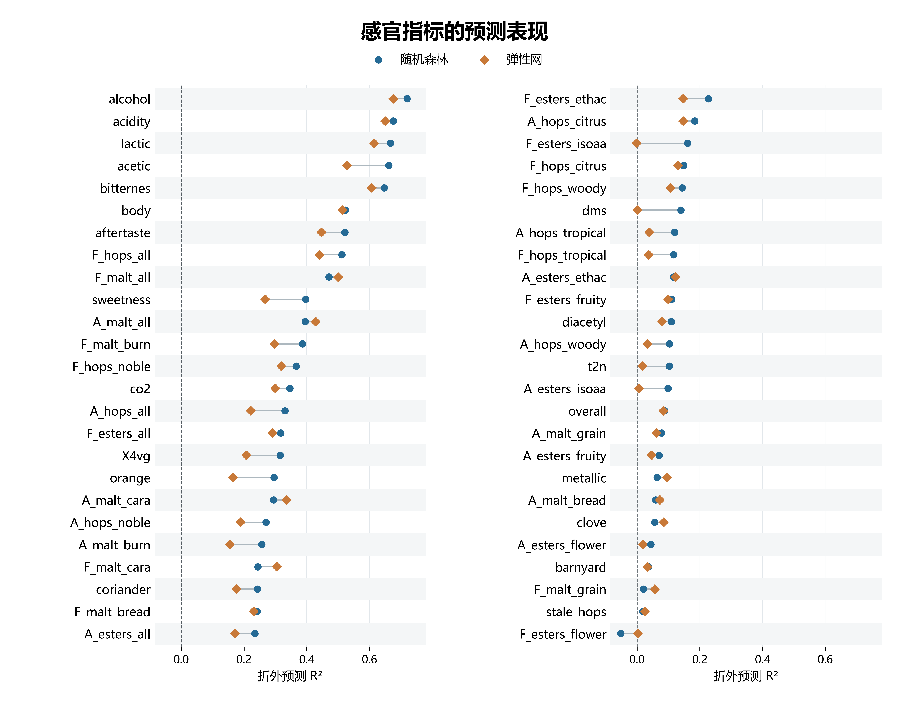
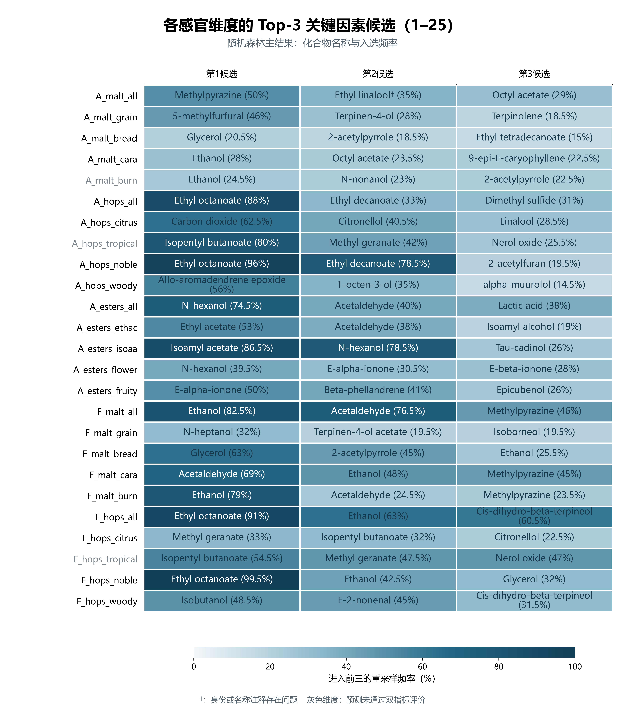
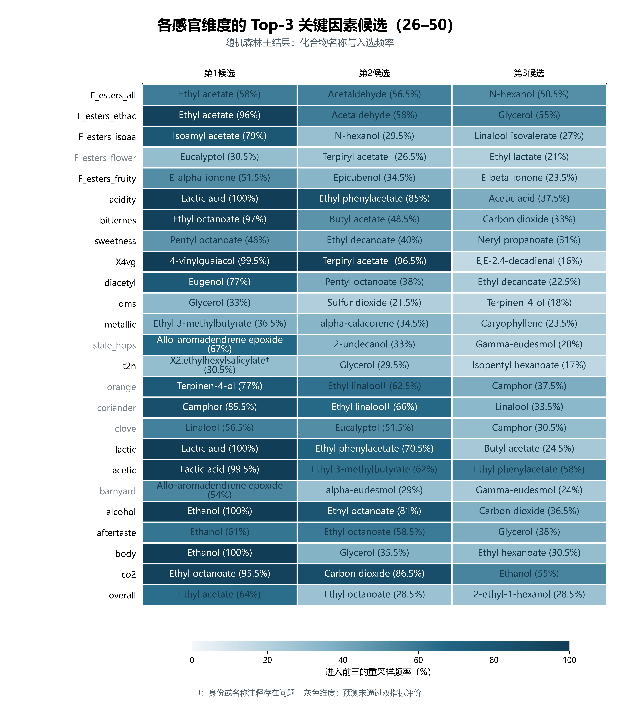
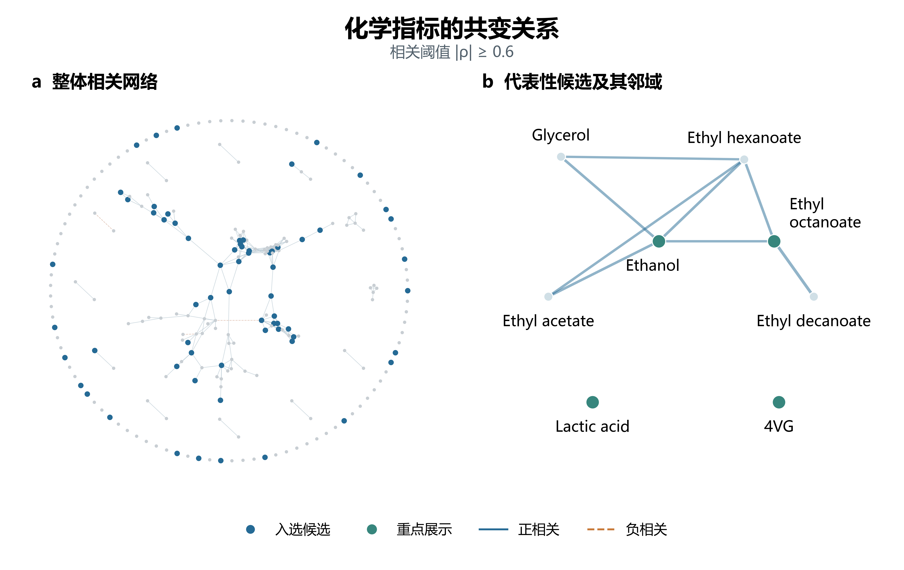

# 问题二：基于化学共变网络与双模型重采样的感官关键因素筛选

## 1 问题分析与建模目标

问题二要求利用化合物相关数据构建共表达图，结合化学测量和感官评分，为每个感官维度给出 Top-3 关键因素化合物，并论证筛选结果的稳定性与化学合理性。与问题一侧重预测感官轮廓不同，本问关注预测信息由哪些化合物提供，以及相应排名能否在样本变化和模型变化后保持一致。

啤酒风味由多种组分共同形成，化合物之间又存在发酵来源和酿造风格引起的相关性。已有啤酒风味研究将化学测量、机器学习及混合添加实验结合，为开展预测关联分析提供了依据[1]。本问将题目中的“共表达”具体定义为化学指标在不同啤酒样本中的共变关系，以随机森林筛选非线性预测关联，以弹性网作为线性稀疏模型对照，再通过重采样入选频率、跨模型集合相似度和文献证据评价候选。

本文所称“关键因素化合物”是按上述规则筛得的优先验证候选。筛选同时考察目标的预测表现、候选选择稳定性和化学解释，三者分别报告，不将高频入选直接等同于已确认的独立感官作用。

## 2 数据处理与化学共变网络

### 2.1 样本对齐与候选范围

以啤酒编号对齐化学测量与专业感官评分，保留全部250个样本和50个连续感官维度，其中香气、风味各15项，其他感官指标20项。目标沿用问题一的字段名及连续感官标尺，已取对数的化学输入不重复变换。

完整化学网络含231个指标。预测主模型去除 `kcalperc`、`esters_sum`、`aroma_hops_sum`、`acids_sum`、`sulfur_sum` 五个派生指标，使用226个输入特征，以减少总量指标与单体指标重复表征的影响。按原始字段分类，其中216个化合物字段进入 Top-3 候选池；8个辅助理化指标和2个未解析字段仍可进入预测模型，但不参与化合物排名。辅助指标包括色度、pH、实测苦味等，候选池因而不等于全部预测因子的集合。

缺失值填补、输入标准化和目标标准化均仅在相应训练集上拟合。弹性网在填补后增加训练集1%和99%分位数缩尾，验证样本沿用训练阈值；随机森林主模型不缩尾。字段分类与后续身份核查分别处理：原有候选中的名称冲突保留统计排名并加注标记，不通过改名或补排掩盖原始记录问题。

### 2.2 共变网络与相关分组

以附件2的化合物相关矩阵作为描述性网络输入，并按成对非缺失观测重算 Spearman 相关系数进行核对。记第 \(j\)、\(k\) 个化学指标的秩相关系数为 \(\rho_{jk}\)，阈值为 \(\tau\)，则无向有符号网络定义为

$$
G_\tau=(V,E_\tau),\qquad
E_\tau=\{(j,k):j<k,\ |\rho_{jk}|\geq\tau\}.
\tag{2-1}
$$

主图取 \(\tau=0.6\)，边的符号保留相关方向，权重取 \(|\rho_{jk}|\)，并使用0.5、0.7检验阈值变化。网络包含全部231个指标，避免只展示已入选化合物而遗漏其共变背景。

为在预测解释中处理相关变量，以 \(d_{jk}=1-|\rho_{jk}|\) 为距离进行平均连接层次聚类，在距离0.3处截断，对应相关分组阈值0.7。每个训练折和每次重采样均重新计算分组。全样本网络用于描述，训练阶段的相关分组用于组级置换解释；网络连通分量与层次聚类分组分别统计。

## 3 双模型筛选与稳定性评价

### 3.1 随机森林与弹性网

随机森林通过树集成拟合非线性关系[2]。在外层验证样本上计算 Tree SHAP，以保留局部预测解释并汇总总体特征贡献[3]。第 \(t\) 个感官目标、第 \(j\) 个输入的折外重要性定义为

$$
I^{\mathrm{RF}}_{jt}
=\frac{1}{250}\sum_{i=1}^{250}
\left|\phi^{\mathrm{OOF}}_{ijt}\right|,
\tag{2-2}
$$

其中，\(\phi^{\mathrm{OOF}}_{ijt}\) 来自未使用样本 \(i\) 训练的外层模型，按树路径依赖方式计算，并恢复到附件给定的连续感官尺度。折外重要性用于总体解释及候选可用性检查，最终 Top-3 则由重采样共识排序确定。

弹性网同时使用稀疏约束和系数收缩，作为相关高维输入下的线性对照[4]。令 \(\mathbf U\) 为训练集标准化输入、\(\mathbf v_t\) 为标准化感官目标，其估计为

$$
\min_{\beta_0,\boldsymbol\beta}
\frac{1}{2n}\left\|\mathbf v_t-\beta_0\mathbf1-\mathbf U\boldsymbol\beta\right\|_2^2
+\alpha\left[
\gamma\|\boldsymbol\beta\|_1
+\frac{1-\gamma}{2}\|\boldsymbol\beta\|_2^2
\right].
\tag{2-3}
$$

对弹性网，采用恢复目标尺度后的绝对系数衡量重要性。两模型的重要性定义不同，后续比较使用候选集合和入选频率，不直接比较其重要性原值。

### 3.2 嵌套交叉验证与预测双指标评价

外层采用5折交叉验证，内层采用3折，以内层 MAE 选择参数。样本划分尽量平衡总体规模和风格构成；样本数少于折数的风格采用轮转分配。预处理与参数选择均在对应训练集内完成，风格标签不作为主模型输入。

**表2-1 模型与重采样参数设置**

| 项目 | 设置 |
|---|---|
| 外层/内层交叉验证 | 5折/3折 |
| RF 树数、最大深度 | 150、8 |
| RF 叶节点最小样本数 | 2或5，由内层选择 |
| RF 每次分裂的特征比例 | 0.5或0.8，由内层选择 |
| EN 正则化强度 \(\alpha\) | \(10^{-3}\)至\(10^1\)，9个对数等距候选 |
| EN 稀疏混合比例 \(\gamma\) | 0.1、0.5、0.9 |
| EN 缩尾分位点 | 训练集1%、99%分位数 |
| 风格分层 Bootstrap | 200次 |
| 相关组联合置换 | 每个外层验证折重复5次 |
| 随机种子 | 42 |

将每个目标的250个折外预测汇总后计算 MAE、RMSE 和 \(R^2\)。常数基线对每个外层验证样本预测其对应训练折的感官评分中位数，记其 MAE 为 \(\mathrm{MAE}_{0,t}\)。定义

$$
R_t^2=1-\frac{\sum_i(y_{it}-\widehat y^{\mathrm{OOF}}_{it})^2}
{\sum_i(y_{it}-\overline y_t)^2},
\qquad
D_t=1-\frac{\mathrm{MAE}_t}{\mathrm{MAE}_{0,t}}.
\tag{2-4}
$$

本章以

$$
C_t=\mathbf1\{R_t^2>0\ \text{且}\ D_t>0\}
\tag{2-5}
$$

作为预测双指标评价标准。\(C_t=1\) 表示模型同时获得正折外 \(R^2\) 和相对于训练中位数基线的 MAE 改善；\(C_t=0\) 标记为“预测未通过双指标评价”。该规则是本章的描述性评价标准，不是显著性检验，也不是化合物文献证据等级。

### 3.3 Bootstrap 入选频率与共识排序

按啤酒风格分层进行200次有放回重采样，各层抽取与原风格相同数量的样本。每次使用全样本交叉验证选定的固定超参数重新拟合模型。RF 在袋外样本上计算平均绝对 SHAP 值，EN 根据重采样模型的绝对系数计算重要性；各次重要性除以该次全部输入的重要性之和进行归一化。

在216个候选字段中，按正重要性选取每次的前三名。记第 \(b\) 次重采样的候选集合为 \(S^{(b)}_t\)，则化合物 \(j\) 的入选频率为

$$
\pi_{jt}=\frac1{200}\sum_{b=1}^{200}
\mathbf1\{j\in S_t^{(b)}\}.
\tag{2-6}
$$

最终依次按入选频率降序、中位排名升序、平均归一化重要性降序和字段名排序，取前三个合格候选；候选还须具有正折外重要性。没有合格候选时不以零重要性变量补齐。

为便于描述，本文将频率达到60%的候选单独统计，其中达到80%的候选作为更高频子集。这两个界限是描述性分档，不表示统计显著性或错误发现率控制。重采样中固定超参数，因此频率反映给定调参方案下的条件选择稳定性。

### 3.4 跨模型比较与相关组解释

记 RF、EN 的共识候选集合分别为 \(S_t^{\mathrm{RF}}\)、\(S_t^{\mathrm{EN}}\)，采用 Jaccard 系数评价一致性：

$$
J_t=\frac{|S_t^{\mathrm{RF}}\cap S_t^{\mathrm{EN}}|}
{|S_t^{\mathrm{RF}}\cup S_t^{\mathrm{EN}}|}.
\tag{2-7}
$$

EN 未选出候选时，以实际集合计算，不人为补足三个变量。

对训练集内确定的相关组，在外层验证集中共同置换该组所有变量的样本行，保留组内的共同变化，计算

$$
\Delta_{g,t}=\frac15\sum_{r=1}^{5}
\left[
\mathrm{MAE}\!\left(y_t,f_t(\mathbf X^{\mathrm{perm}(g,r)})\right)
-\mathrm{MAE}\!\left(y_t,f_t(\mathbf X)\right)
\right].
\tag{2-8}
$$

\(\Delta_{g,t}>0\) 表示破坏该组信息后预测误差增加。各折的分组可能不同，故按每个化合物所在组追踪结果，不直接合并不同折的局部分组编号。组贡献不能全部归于组内某一单体。

## 4 求解结果与化学解释

### 4.1 逐目标预测表现

**表2-2 双模型的折外预测结果**

| 模型 | 平均MAE | 平均RMSE | 平均R² | 满足双指标标准的目标数 |
|---|---|---|---|---|
| 随机森林（RF） | 0.3393 | 0.4729 | 0.2540 | 41/50 |
| 弹性网（EN） | 0.3515 | 0.4885 | 0.2117 | 33/50 |

注：先汇总每个目标的250个折外预测计算指标，再对50个目标取算术平均。该口径与问题一先逐折计算宏平均再汇总的口径不同，不据此直接比较两问模型的优劣。

**图2-1 感官指标的折外预测表现。** 全部50个目标按 RF 的折外 \(R^2\) 降序排列，先左列后右列；两种符号表示 RF 与 EN，同一行连线配对同一目标。\(R^2=0\) 为参照线。

RF 的平均 MAE 为0.3393，平均 \(R^2\) 为0.2540；EN 分别为0.3515和0.2117。RF 在41个目标上满足式（2-5），EN 为33个。RF 在 `alcohol`、`acidity`、`lactic`、`acetic`、`bitternes` 上的 \(R^2\) 分别为0.7201、0.6759、0.6671、0.6616、0.6472；`overall` 仅为0.0877，预测能力存在明显的目标差异。

RF 中未通过双指标评价的9个目标为 `A_malt_burn`、`A_hops_tropical`、`F_hops_tropical`、`F_esters_flower`、`stale_hops`、`orange`、`coriander`、`clove`、`barnyard`。其中8个目标仍具有正 \(R^2\)，但9个目标的 MAE 均未优于训练中位数基线。例如，`orange` 的 \(R^2=0.2958\)，MAE 为0.3123，高于基线0.2720，相对改善率为−14.79%。\(R^2\) 使用平方误差及全目标均值参照，MAE 基线使用各训练折中位数，两项评价结果可以不同。

### 4.2 各感官维度的 Top-3 关键因素候选

RF 为全部50个感官维度各选出3个不同候选，共150条目标—候选记录，涉及66个不同字段。EN 共得到145条记录：`A_esters_isoaa` 无合格候选，`F_esters_isoaa` 仅有1个，其余目标各3个。RF 结果作为主名单，EN 用于方法对照。

**图2-2 第1—25个感官维度的 Top-3 候选及入选频率。** 行顺序沿用原始感官字段，三列按共识排名排列，每格标出化合物名称和200次重采样的入选频率。灰色维度表示预测未通过式（2-5）的双指标评价；†表示名称或身份注释问题。

**图2-3 第26—50个感官维度的 Top-3 候选及入选频率。** 编码方式与图2-2相同。颜色和括号内百分数均表示入选频率，不表示重要性份额或感官效应大小。

**表2-3 全部50个感官维度的 RF 共识 Top-3**

| 感官维度 | 第1候选 | 第2候选 | 第3候选 | 预测评价 |
|---|---|---|---|---|
| `A_malt_all` | Methylpyrazine（50.0%） | Ethyl linalool†（35.0%） | Octyl acetate（29.0%） | 通过 |
| `A_malt_grain` | 5-methylfurfural（46.0%） | Terpinen-4-ol（28.0%） | Terpinolene（18.5%） | 通过 |
| `A_malt_bread` | Glycerol（20.5%） | 2-acetylpyrrole（18.5%） | Ethyl tetradecanoate（15.0%） | 通过 |
| `A_malt_cara` | Ethanol（28.0%） | Octyl acetate（23.5%） | 9-epi-E-caryophyllene（22.5%） | 通过 |
| `A_malt_burn` | Ethanol（24.5%） | N-nonanol（23.0%） | 2-acetylpyrrole（22.5%） | 未通过 |
| `A_hops_all` | Ethyl octanoate（88.0%） | Ethyl decanoate（33.0%） | Dimethyl sulfide（31.0%） | 通过 |
| `A_hops_citrus` | Carbon dioxide（62.5%） | Citronellol（40.5%） | Linalool（28.5%） | 通过 |
| `A_hops_tropical` | Isopentyl butanoate（80.0%） | Methyl geranate（42.0%） | Nerol oxide（25.5%） | 未通过 |
| `A_hops_noble` | Ethyl octanoate（96.0%） | Ethyl decanoate（78.5%） | 2-acetylfuran（19.5%） | 通过 |
| `A_hops_woody` | Allo-aromadendrene epoxide（56.0%） | 1-octen-3-ol（35.0%） | alpha-muurolol（14.5%） | 通过 |
| `A_esters_all` | N-hexanol（74.5%） | Acetaldehyde（40.0%） | Lactic acid（38.0%） | 通过 |
| `A_esters_ethac` | Ethyl acetate（53.0%） | Acetaldehyde（38.0%） | Isoamyl alcohol（19.0%） | 通过 |
| `A_esters_isoaa` | Isoamyl acetate（86.5%） | N-hexanol（78.5%） | Tau-cadinol（26.0%） | 通过 |
| `A_esters_flower` | N-hexanol（39.5%） | E-alpha-ionone（30.5%） | E-beta-ionone（28.0%） | 通过 |
| `A_esters_fruity` | E-alpha-ionone（50.0%） | Beta-phellandrene（41.0%） | Epicubenol（26.0%） | 通过 |
| `F_malt_all` | Ethanol（82.5%） | Acetaldehyde（76.5%） | Methylpyrazine（46.0%） | 通过 |
| `F_malt_grain` | N-heptanol（32.0%） | Terpinen-4-ol acetate（19.5%） | Isoborneol（19.5%） | 通过 |
| `F_malt_bread` | Glycerol（63.0%） | 2-acetylpyrrole（45.0%） | Ethanol（25.5%） | 通过 |
| `F_malt_cara` | Acetaldehyde（69.0%） | Ethanol（48.0%） | Methylpyrazine（45.0%） | 通过 |
| `F_malt_burn` | Ethanol（79.0%） | Acetaldehyde（24.5%） | Methylpyrazine（23.5%） | 通过 |
| `F_hops_all` | Ethyl octanoate（91.0%） | Ethanol（63.0%） | Cis-dihydro-beta-terpineol（60.5%） | 通过 |
| `F_hops_citrus` | Methyl geranate（33.0%） | Isopentyl butanoate（32.0%） | Citronellol（22.5%） | 通过 |
| `F_hops_tropical` | Isopentyl butanoate（54.5%） | Methyl geranate（47.5%） | Nerol oxide（47.0%） | 未通过 |
| `F_hops_noble` | Ethyl octanoate（99.5%） | Ethanol（42.5%） | Glycerol（32.0%） | 通过 |
| `F_hops_woody` | Isobutanol（48.5%） | E-2-nonenal（45.0%） | Cis-dihydro-beta-terpineol（31.5%） | 通过 |
| `F_esters_all` | Ethyl acetate（58.0%） | Acetaldehyde（56.5%） | N-hexanol（50.5%） | 通过 |
| `F_esters_ethac` | Ethyl acetate（96.0%） | Acetaldehyde（58.0%） | Glycerol（55.0%） | 通过 |
| `F_esters_isoaa` | Isoamyl acetate（79.0%） | N-hexanol（29.5%） | Linalool isovalerate（27.0%） | 通过 |
| `F_esters_flower` | Eucalyptol（30.5%） | Terpiryl acetate†（26.5%） | Ethyl lactate（21.0%） | 未通过 |
| `F_esters_fruity` | E-alpha-ionone（51.5%） | Epicubenol（34.5%） | E-beta-ionone（23.5%） | 通过 |
| `acidity` | Lactic acid（100.0%） | Ethyl phenylacetate（85.0%） | Acetic acid（37.5%） | 通过 |
| `bitternes` | Ethyl octanoate（97.0%） | Butyl acetate（48.5%） | Carbon dioxide（33.0%） | 通过 |
| `sweetness` | Pentyl octanoate（48.0%） | Ethyl decanoate（40.0%） | Neryl propanoate（31.0%） | 通过 |
| `X4vg` | 4-vinylguaiacol（99.5%） | Terpiryl acetate†（96.5%） | E,E-2,4-decadienal（16.0%） | 通过 |
| `diacetyl` | Eugenol（77.0%） | Pentyl octanoate（38.0%） | Ethyl decanoate（22.5%） | 通过 |
| `dms` | Glycerol（33.0%） | Sulfur dioxide（21.5%） | Terpinen-4-ol（18.0%） | 通过 |
| `metallic` | Ethyl 3-methylbutyrate（36.5%） | alpha-calacorene（34.5%） | Caryophyllene（23.5%） | 通过 |
| `stale_hops` | Allo-aromadendrene epoxide（67.0%） | 2-undecanol（33.0%） | Gamma-eudesmol（20.0%） | 未通过 |
| `t2n` | X2.ethylhexylsalicylate†（30.5%） | Glycerol（29.5%） | Isopentyl hexanoate（17.0%） | 通过 |
| `orange` | Terpinen-4-ol（77.0%） | Ethyl linalool†（62.5%） | Camphor（37.5%） | 未通过 |
| `coriander` | Camphor（85.5%） | Ethyl linalool†（66.0%） | Linalool（33.5%） | 未通过 |
| `clove` | Linalool（56.5%） | Eucalyptol（51.5%） | Camphor（30.5%） | 未通过 |
| `lactic` | Lactic acid（100.0%） | Ethyl phenylacetate（70.5%） | Butyl acetate（24.5%） | 通过 |
| `acetic` | Lactic acid（99.5%） | Ethyl 3-methylbutyrate（62.0%） | Ethyl phenylacetate（58.0%） | 通过 |
| `barnyard` | Allo-aromadendrene epoxide（54.0%） | alpha-eudesmol（29.0%） | Gamma-eudesmol（24.0%） | 未通过 |
| `alcohol` | Ethanol（100.0%） | Ethyl octanoate（81.0%） | Carbon dioxide（36.5%） | 通过 |
| `aftertaste` | Ethanol（61.0%） | Ethyl octanoate（58.5%） | Glycerol（38.0%） | 通过 |
| `body` | Ethanol（100.0%） | Glycerol（35.5%） | Ethyl hexanoate（30.5%） | 通过 |
| `co2` | Ethyl octanoate（95.5%） | Carbon dioxide（86.5%） | Ethanol（55.0%） | 通过 |
| `overall` | Ethyl acetate（64.0%） | Ethyl octanoate（28.5%） | 2-ethyl-1-hexanol（28.5%） | 通过 |

注：括号为入选频率；“预测评价”依据式（2-5），不表示该行三个化合物均已获得独立感官验证。†对应 `ethyl..E..linalool`、`delta.terpinyl.acetate` 及 `X2.ethylhexylsalicylate`，身份问题见第4.4节。冲突字段按分析信号保留，不作为身份已经确认的化合物解释。

### 4.3 代表性化学关系

**表2-4 代表性关系在双模型中的入选频率**

| 感官维度 | 化合物名称 | RF入选频率 | 同一化合物的EN入选频率 |
|---|---|---|---|
| `alcohol` | Ethanol | 100.0% | 86.0% |
| `acidity` | Lactic acid | 100.0% | 100.0% |
| `lactic` | Lactic acid | 100.0% | 98.5% |
| `X4vg` | 4-vinylguaiacol | 99.5% | 100.0% |
| `bitternes` | Ethyl octanoate | 97.0% | 95.0% |
| `acetic` | Lactic acid | 99.5% | 100.0% |
| `A_hops_noble` | Ethyl octanoate | 96.0% | 87.0% |

注：EN 列为同一化合物的入选频率，不是 EN 同一名次候选的频率。

`alcohol` 的首位候选为 Ethanol，RF 入选频率100%，EN 为86%；Lactic acid 在 `acidity` 和 `lactic` 中的 RF 频率均为100%，EN 分别为100%和98.5%。这些关系与化学身份及相应感官含义一致，也与已有啤酒感官建模研究相容[1]。4-vinylguaiacol 在 `X4vg` 中的频率为99.5%和100%，其挥发性酚感官背景已有啤酒研究支持[5]。

Ethyl octanoate 在 `bitternes` 中的频率为97%和95%，说明该关联在两种模型下均较稳定；个体酯类感官研究支持其参与啤酒复杂风味[6]。不过，模型中辅助指标 `bitterness` 的折外重要性份额约为0.2135，高于 Ethyl octanoate 的0.1371，而前者不参与化合物榜单。因此 Ethyl octanoate 居化合物榜首不等于它在全部预测因子中居首，也不能据此识别其为直接苦味来源。

麦芽相关候选中的 Methylpyrazine、2-acetylpyrrole、5-methylfurfural、2-acetylfuran 可以联系麦芽加工与焙烤、焦糖、面包类香气背景，特种麦芽研究提供了相应来源依据[7]。例如 Methylpyrazine 在 `A_malt_all` 居首，但频率仅50%，化学背景支持不应替代稳定性评价。

酒花柑橘相关候选中的 Linalool、Citronellol 具有单萜醇感官研究背景。相关实验涉及 Geraniol、Citronellol 与 Linalool 的协同[8]，酵母研究亦观察到酒花挥发物和感官特征随菌株变化[9]。这些文献支持来源与类别解释，不能将其结论直接迁移至名称相近的衍生物或所有细分目标。混合物添加结果同样不能分解为每个单体的独立效应[1]。

### 4.4 名称冲突与化学解释边界

`X2.ethylhexylsalicylate` 在 `t2n` 中排名第一，入选频率30.5%。该字段指向 2-ethylhexyl salicylate，而原名称表写为 2-ethylhexyl acrylate。欧盟及 ECHA 的物质信息分别对应 CAS 118-60-5 和 CAS 103-11-7，二者为不同物质[10–11]。现有资料无法确定实际测量列身份，故保留字段及排名，以†标记为分析信号，不指定确定化学机制。

`delta.terpinyl.acetate` 的名称表为 Terpiryl acetate，异构体标注不足；`ethyl..E..linalool` 的名称为 Ethyl linalool，不能与普通 Linalool 合并。这两类字段同样保留统计结果并标注†。尤其 `X4vg` 中 Terpiryl acetate 的频率达到96.5%，高入选频率仍不能解决身份注释问题。

文献中的检出记录仅提供存在性与来源背景。例如色谱研究检出了多种啤酒挥发物[12]，但“检出”不能替代针对具体感官目标的作用验证。Ethyl phenylacetate 与 Phenethyl acetate、N-hexanol 与 Hexanal 也须分别处理，避免由名称近似引入错误解释。

本章不将模型输入直接换算为气味活度值。该计算需要逐物质确认原始浓度、单位、异构体及啤酒介质中的适用阈值，现有字段的表示与标定条件并不统一；`CO2.PSI.` 更是压力相关量，不能直接视为溶解 Carbon dioxide 浓度。

## 5 稳定性与敏感性分析

### 5.1 重采样选择稳定性

150条 RF 候选中，41条的入选频率达到60%，其中21条达到80%；22个感官目标的三个候选均低于60%。只有 `F_hops_all` 的三个 RF 候选均达到60%，分别为 Ethyl octanoate（91%）、Ethanol（63%）和 Cis-dihydro-beta-terpineol（60.5%）。这表明稳定选择集中在部分目标与候选，不能将完整名单等同于150条同等可靠的结论。

预测表现与入选频率分别反映不同问题。Camphor 在 `coriander` 中的频率达到85.5%，但该目标未通过预测双指标评价；该高频结果仅说明在既定训练方案下重复选择了同一候选，不能弥补目标预测表现的限制。反之，某目标即使通过预测评价，也可能因相关变量共享信息而得到低频或可替代的候选。

### 5.2 跨模型一致性

RF 与 EN 的平均 Jaccard 系数为0.192。50个目标中，14个目标的集合完全不重合，28个的系数为0.2，8个为0.5，没有两个集合完全一致的目标。EN 的145条候选中，26条达到60%，12条达到80%。整体候选集合对模型假设较敏感，表2-4所列的少数核心关系则同时获得较高频率支持。

RF 与 EN 分别衡量非线性预测贡献和正则化线性系数，相关输入下还可能选择不同代理变量。因此低 Jaccard 系数应作为方法依赖性报告，不能简单解释为某一模型全部错误，也不能据局部一致关系宣称所有目标跨模型一致。

### 5.3 输入方案敏感性

**表2-5 RF 输入方案敏感性结果**

| RF输入方案 | 平均R² | 平均MAE |
|---|---|---|
| 主模型 | 0.2540 | 0.3393 |
| 加入风格变量 | 0.2576 | 0.3383 |
| 加入1%缩尾 | 0.2540 | 0.3394 |
| 加入派生指标 | 0.2564 | 0.3381 |

各敏感性方案沿用主模型选定参数，未逐方案重新调参。加入风格后平均 \(R^2\) 增加约0.0036，加入派生指标后增加约0.0024，1%缩尾对总体平均值影响很小。该结果表明平均预测表现对上述输入处理的变化幅度较小，但不能据此认定所有单目标排名不变，或认为风格混杂已经被消除。

### 5.4 共变网络与阈值敏感性

**图2-4 化学共变网络及代表性候选邻域。** （a）全部231个指标在 \(|\rho|\geq0.6\) 下的网络，蓝色为任一 RF 主名单中的候选字段，孤立节点放在外圈。（b）Ethanol、Ethyl octanoate、Lactic acid、4VG 及每个节点最多三个相关强度最高的主模型邻居，共8个节点，展示其间全部8条达阈值边。线宽表示 \(|\rho|\)，实线与虚线区分正、负相关。位置用于排版，不编码效应大小。

主阈值下，网络包含266条边、101个孤立节点和114个连通分量。Ethanol 与 Ethyl hexanoate、Glycerol、Ethyl acetate、Ethyl octanoate 的相关系数分别约为0.740、0.733、0.719、0.655；Ethyl octanoate 与 Ethyl decanoate 的相关系数约为0.853。发酵指标间的共同变化为代理关联提供了背景，解释时需要结合相关组而非仅依赖单体排名。

相关组联合置换也显示了相应信息的预测贡献：Ethanol 所在组对 `alcohol` 的平均 MAE 增量为0.2135，Lactic acid 所在组对 `acidity` 为0.1572，4VG 所在组对 `X4vg` 为0.0796，三组关系的五个外层折平均增量均为正。这些数值衡量相关组被共同扰动后的误差变化，并不分离单体效应。

Lactic acid 和4VG在该阈值下均为孤立节点，却分别在酸感及对应酚感中具有较高预测贡献。因此，强相关网络的中心性不是入选关键候选的必要条件，孤立也不表示统计独立或不存在较弱关联。

**表2-6 化学网络的相关阈值敏感性**

| 相关阈值 | 边数 | 孤立节点数 | 连通分量数 | 层次聚类数 | 与0.7方案的ARI |
|---|---|---|---|---|---|
| 0.5 | 645 | 48 | 52 | 117 | 0.423 |
| 0.6 | 266 | 101 | 114 | 159 | 0.757 |
| 0.7 | 109 | 150 | 169 | 186 | 1.000 |

注：ARI 比较平均连接聚类分组与0.7方案的一致性，不比较网络连通分量。

阈值由0.5提高至0.7时，边数从645降至109，孤立节点从48增至150，网络密度对阈值存在明显依赖。0.6与0.7的聚类 ARI 为0.757，0.5与0.7为0.423；因此主图仅表示给定阈值下的结构，不将整体拓扑描述为完全稳健。

## 6 模型评价与适用范围

本方法完整覆盖50个感官维度，将化合物共变、折外预测、重采样选择及化学文献结合，形成可追溯的150条主候选。其结果适用于确定后续核验的优先顺序，并分别标识目标预测、选择稳定性与身份注释的限制。

现有结果的适用边界在于：Bootstrap 固定全样本调参结果，未计入每次重采样重新调参的变动；EN 缩尾方案在探索阶段确定，尚无独立样本检验最终方案；共变网络及组级置换仍受相关结构和阈值影响；部分候选仅具类别或检出背景，三个字段还存在名称注释问题。相应结果不用于推断单体添加的确定感官效应或直接计算配方改变量。

在上述范围内，Ethanol—`alcohol`、Lactic acid—`acidity`/`lactic`、4-vinylguaiacol—`X4vg` 等关系兼具较高入选频率与相容的化学背景；低频、预测未通过双指标评价及身份未确认的记录，则以明确标记随完整名单报告。

## 参考文献

[1] Schreurs M, Piampongsant S, Roncoroni M, et al. Predicting and improving complex beer flavor through machine learning[J]. Nature Communications, 2024, 15: 2368. [DOI: 10.1038/s41467-024-46346-0](https://doi.org/10.1038/s41467-024-46346-0).

[2] Breiman L. Random forests[J]. Machine Learning, 2001, 45: 5–32. [DOI: 10.1023/A:1010933404324](https://doi.org/10.1023/A:1010933404324).

[3] Lundberg S M, Erion G, Chen H, et al. From local explanations to global understanding with explainable AI for trees[J]. Nature Machine Intelligence, 2020, 2: 56–67. [DOI: 10.1038/s42256-019-0138-9](https://doi.org/10.1038/s42256-019-0138-9).

[4] Zou H, Hastie T. Regularization and variable selection via the elastic net[J]. Journal of the Royal Statistical Society: Series B, 2005, 67(2): 301–320. [DOI: 10.1111/j.1467-9868.2005.00503.x](https://doi.org/10.1111/j.1467-9868.2005.00503.x).

[5] Vanbeneden N, Gils F, Delvaux F, et al. Formation of 4-vinyl and 4-ethyl derivatives from hydroxycinnamic acids: Occurrence of volatile phenolic flavour compounds in beer and distribution of Pad1-activity among brewing yeasts[J]. Food Chemistry, 2008, 107(1): 221–230. [出版方页面](https://www.sciencedirect.com/science/article/pii/S0308814607007844).

[6] Xu Y, et al. Flavor contribution of esters in lager beers and an analysis of their flavor thresholds[J]. Journal of the American Society of Brewing Chemists, 2017, 75(3): 201–206. [DOI: 10.1094/ASBCJ-2017-3007-01](https://doi.org/10.1094/ASBCJ-2017-3007-01).

[7] Pan Q, Zhu J, Yin Y, et al. Preparation of specialty malt through explosive puffing: Characterization of quality attributes and its effect on beer quality[J]. Foods, 2026, 15(6): 1113. [DOI: 10.3390/foods15061113](https://doi.org/10.3390/foods15061113).

[8] Takoi K, Itoga Y, Koie K, et al. The contribution of geraniol metabolism to the citrus flavour of beer: Synergy of geraniol and β-citronellol under coexistence with excess linalool[J]. Journal of the Institute of Brewing, 2010, 116(3): 251–260. [DOI: 10.1002/j.2050-0416.2010.tb00428.x](https://doi.org/10.1002/j.2050-0416.2010.tb00428.x).

[9] Kumar A, Warburton A, Silcock P, et al. Yeast strain influences the hop-derived sensory properties and volatile composition of beer[J]. Foods, 2023, 12(5): 1064. [DOI: 10.3390/foods12051064](https://doi.org/10.3390/foods12051064).

[10] European Commission. Opinion concerning 2-ethylhexyl salicylate[EB/OL]. 1998[2026-10-28]. [官方物质意见](https://ec.europa.eu/health/scientific_committees/consumer_safety/opinions/sccnfp_opinions_97_04/sccp_out26_en.htm).

[11] European Chemicals Agency. 2-ethylhexyl acrylate: Substance information[EB/OL]. [2026-10-28]. [官方物质信息](https://echa.europa.eu/substance-information/-/substanceinfo/100.002.801).

[12] Paiva A C, Oliveira D S, Hantao L W. A bottom-up approach for data mining in bioaromatization of beers using flow-modulated comprehensive two-dimensional gas chromatography/mass spectrometry[J]. Separations, 2019, 6(4): 46. [DOI: 10.3390/separations6040046](https://doi.org/10.3390/separations6040046).
