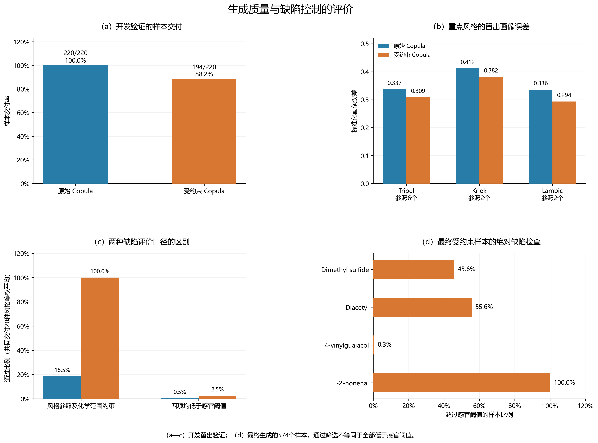
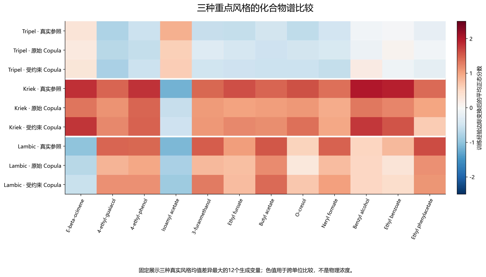
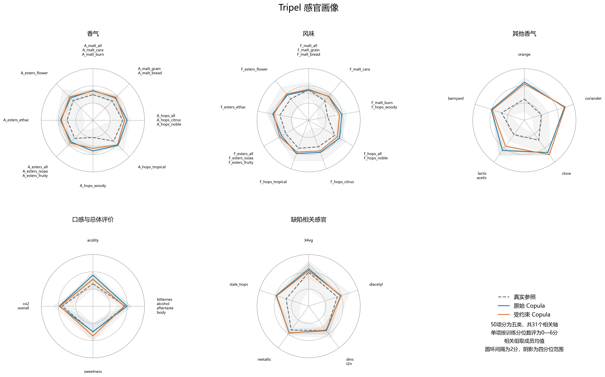
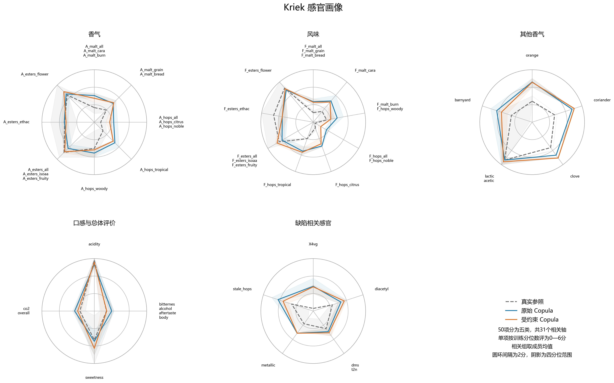
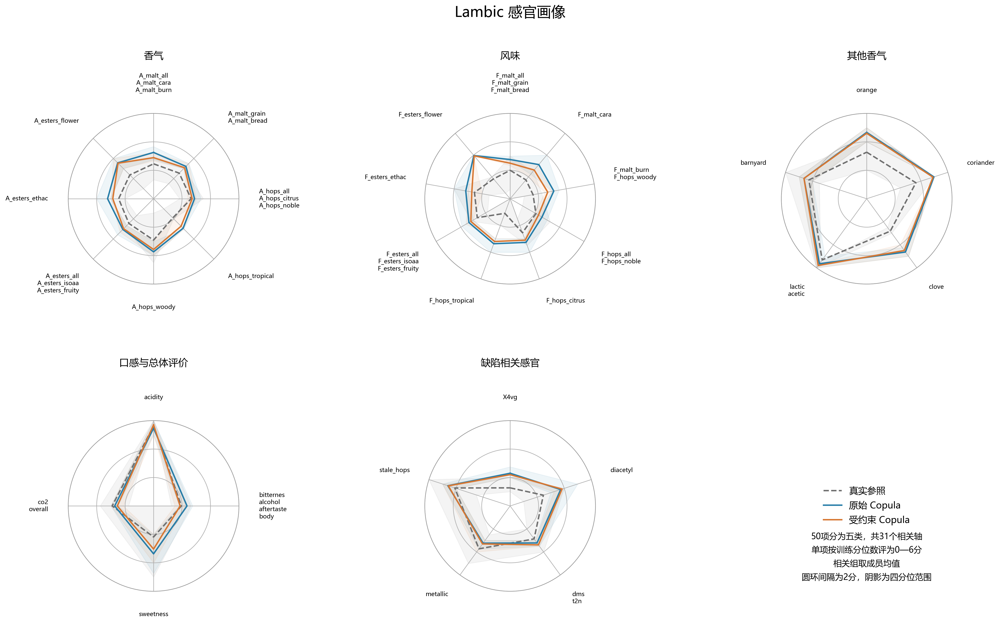
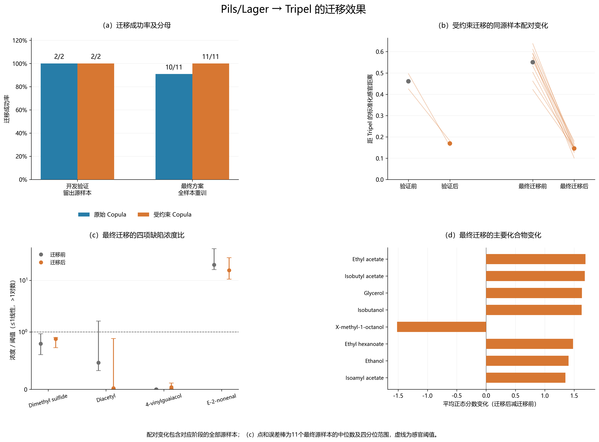

# 问题三：基于收缩条件 Gaussian Copula 的风格化合物谱生成与受约束迁移

## 1 问题分析与建模目标

问题三要求在给定啤酒风格的条件下生成合理的化合物谱，并将已有啤酒的化合物谱迁移至目标风格。本问以 `tasting_category_fine` 为条件变量，学习风格条件分布 \(p(\mathbf x\mid s)\)，再利用问题一的化学—感官预测模型检验生成谱。评价分别回答三个问题：生成结果是否接近目标风味，化学范围及缺陷是否符合约束，迁移后是否比原样本更接近目标。

不同化合物的数值范围、分布形态和相关结构差异较大，各风格的样本量又远小于化学变量数。直接对原始变量拟合高维正态分布会混淆边际分布与变量依赖；逐列独立抽样则会破坏化合物间的关联。Gaussian Copula 通过单调边际变换连接非高斯观测与潜在高斯结构，可作为半参数建模的基础[1]。针对风格小样本下协方差估计不稳定的问题，本文进一步采用共享协方差及风格收缩估计，借用其他风格的信息。

最终对照限定为同一个收缩条件 Gaussian Copula 的两条流程：原始抽样，以及化学缺陷条件抽样与正向筛选。两者共享生成器与训练数据，因此结果用于评价约束流程带来的变化，不用于证明不同生成模型之间的优劣。

## 2 数据表示与验证设计

### 2.1 生成变量与输出字段

按啤酒编号对齐全部250个样本、22种风格和50个连续感官指标。原化学表包含231个字段；生成器去除5个派生汇总项及1个内标字段，实际生成225个变量。去除的汇总项为 `kcalperc`、`esters_sum`、`aroma_hops_sum`、`acids_sum`、`sulfur_sum`，内标字段为 `X3.methyl.2.butenal`。

输出工作簿仍提供231列展示谱。其中，225列来自生成器，5个汇总项按训练近邻估计补齐，内标固定为训练中位数。补齐项不参与感官预测和约束检验，因此不能把展示表的全部231列视为独立生成的配方变量。

四种缺陷相关化合物采用附件8的校准浓度：Dimethyl sulfide、Diacetyl、4-vinylguaiacol 和 E-2-nonenal。其余变量沿用原表表示，已取对数的输入不再重复变换。不同字段不能直接按数值大小比较，也不能将全部输出解释为同一单位的物理浓度。

### 2.2 开发留出与最终交付

按风格分层划分200个训练样本和50个留出样本。缺失值填补、经验边际、感官模型、风格识别器及约束门槛均在训练部分拟合。感官正向模型沿用问题一选定的 TargetBlend 方法，在训练内部通过3折预测完成选参及融合。

开发验证阶段，每种风格、每条流程请求生成10个样本；最终阶段以全部250个真实样本重新拟合，每种风格请求生成30个样本。最终重训结果用于交付候选谱，开发留出结果用于评价。由于方案迭代已参考过先前验证表现，本文将其称为开发留出验证，不作为完全独立的最终测试。

本文数值对应现有运行记录： [开发验证工作簿](运行结果/Q3_20261028_204121_710398/Q3_验证结果.xlsx)与[最终生成工作簿](运行结果/Q3_20261028_204121_710398/Q3_全部结果.xlsx)；源谱、迁移谱及逐项检查见[迁移工作簿](运行结果/Q3_20261028_204121_710398/Pils_Lager_to_Tripel.xlsx)。

**表3-1 主要参数设置**

| 项目 | 设置 |
|---|---|
| 训练／开发留出样本数 | 200／50 |
| 生成维数／展示字段数 | 225／231 |
| 均值收缩强度 \(\kappa_\mu\) | 5 |
| 协方差收缩强度 \(\kappa_\Sigma\) | 20 |
| 协方差数值稳定项 | \(10^{-5}\mathbf I\) |
| 训练内部范围校准 | 3折，合并全部风格，经验覆盖水平0.975 |
| 风味距离容忍系数 | 1.25 |
| 风格缺陷参照分位数 | 0.75 |
| 验证／最终每风格请求数 | 10／30 |
| 每轮候选池 | 请求数的20倍，受约束流程最多2轮 |
| 缺陷边际 Gibbs 迭代 | 60步 |
| 每个源样本的迁移候选数 | 1000 |
| 迁移修改成本系数 | 0.5 |
| 随机种子 | 42 |

这些参数是本次运行设置。现有结果未进行多随机种子或参数扰动实验，不据此声称参数不敏感或最优。

## 3 收缩条件 Gaussian Copula

### 3.1 训练经验边际变换

对训练集内的第 \(j\) 个变量，先用训练中位数填补缺失。记不同观测值为 \(u_{j1}<\cdots<u_{jK_j}\)，对应重复次数为 \(c_{jk}\)，采用中位秩概率

$$
p_{jk}=\frac{\sum_{\ell\leq k}c_{j\ell}-c_{jk}/2}{n},\qquad
v_{jk}=\Phi^{-1}\!\left(\operatorname{clip}(p_{jk},10^{-5},1-10^{-5})\right).
\tag{3-1}
$$

在节点 \((u_{jk},v_{jk})\) 之间进行分段线性插值，得到单调正态分数变换 \(T_j\)。常数列映射为0。记

$$
\mathbf z_i=T(\mathbf x_i).
\tag{3-2}
$$

生成时使用相同节点的逆插值恢复观测表示。逆变换不外推训练观测范围，有助于避免任意浓度外推，也意味着模型不能探索训练边际之外的新化学范围。

### 3.2 风格均值与协方差收缩

设风格 \(s\) 有 \(n_s\) 个训练样本，潜在空间的样本均值、协方差分别为 \(\overline{\mathbf z}_s\)、\(\mathbf S_s\)，全体潜在均值为 \(\overline{\mathbf z}\)。先从每个潜在样本减去所属风格均值，对合并残差使用 Ledoit–Wolf 估计得到共享协方差 \(\boldsymbol\Sigma_0\)。协方差收缩可改善高维样本协方差的条件数及估计稳定性[2]。

本问的风格参数定义为

$$
\widehat{\boldsymbol\mu}_s=
\frac{n_s\overline{\mathbf z}_s+5\overline{\mathbf z}}{n_s+5},
\qquad
\widehat{\boldsymbol\Sigma}_s=
\frac{n_s}{n_s+20}\mathbf S_s+
\frac{20}{n_s+20}\boldsymbol\Sigma_0+10^{-5}\mathbf I.
\tag{3-3}
$$

当某风格样本不足以计算独立样本协方差时，使用共享协方差。由此形成风格条件潜在分布

$$
\mathbf z^*\mid s\sim
\mathcal N(\widehat{\boldsymbol\mu}_s,\widehat{\boldsymbol\Sigma}_s),
\qquad
\mathbf x^*=T^{-1}(\mathbf z^*).
\tag{3-4}
$$

本模型使用训练集共享的经验边际，通过潜在高斯参数表达风格差异；没有为每个小样本风格分别估计完整经验边际。

## 4 正向筛选与缺陷约束

### 4.1 目标风味距离

令问题一方法重新拟合的正向模型为 \(\widehat{\mathbf y}=f(\mathbf x)\)。对30个 `A_`、`F_` 香气和风味指标，以目标风格真实训练均值 \(\boldsymbol\mu_s^y\) 为参照，用全训练集各指标标准差 \(\sigma_t\) 标准化，定义

$$
D_F(\mathbf x,s)=\frac1{30}\sum_{t\in\mathcal A\cup\mathcal F}
\frac{|f_t(\mathbf x)-\mu^y_{s,t}|}{\sigma_t}.
\tag{3-5}
$$

近常数目标的标准化尺度取1，避免除以零。风格风味门槛取训练内部折外预测距离的95%分位数乘1.25，并设置0.1的下限。该门槛用于生成筛选；50项完整感官评分另行展示，其他20项并未全部纳入式（3-5）。

### 4.2 化学支持范围与风格支持

化学合理性同时检查风格潜在联合距离和最近真实训练样本距离：

$$
D_C(\mathbf x,s)=\sqrt{\frac{(T(\mathbf x)-\widehat{\boldsymbol\mu}_s)^\top
\widehat{\boldsymbol\Sigma}_s^{-1}(T(\mathbf x)-\widehat{\boldsymbol\mu}_s)}{225}},
\quad
D_N(\mathbf x)=\min_i\frac{\|T(\mathbf x)-T(\mathbf x_i)\|_2}{\sqrt{225}}.
\tag{3-6}
$$

在训练内部3折中重新拟合生成器，对未参与相应拟合的真实样本计算上述距离，合并风格后按0.975经验覆盖水平校准。联合距离门槛同时不低于理论高斯半径。开发阶段 \(D_C\)、\(D_N\) 门槛分别为2.4125、1.0994；最终重训时分别为2.4960、1.1464。

另在潜在空间拟合多项 Logistic 风格识别器，以目标风格负对数预测概率检验风格支持，其门槛同样由训练内部折外样本校准。最高概率类别是否等于目标风格单独报告，不作为一票否决条件。合并风格校准没有提供严格的逐风格覆盖保证，识别概率也不直接等同于真实风格达成概率。

### 4.3 化学缺陷与陈旧酒花代理

本次采用风格参照策略。四种化学缺陷的风格上限为

$$
U_{s,j}=\max\left\{\tau_j,
Q_{0.75}(x_{ij}:s_i=s)\right\},
\tag{3-7}
$$

其中 \(\tau_j\) 为运行中采用的感官阈值。Dimethyl sulfide、Diacetyl、4-vinylguaiacol 的阈值分别为19 μg/L、0.09 mg/L、0.20 mg/L，来自附件8；E-2-nonenal 的运行阈值为0.0001 mg/L。阈值用于感官评价，不是食品安全限值。

约束抽样先将浓度上限映射到潜在空间，对四维缺陷边际进行60步 Gibbs 近似截断联合抽样，再按条件高斯分布生成其他变量。这样保留缺陷变量与其余化合物的条件关联，避免独立裁剪浓度。有限步 Gibbs 不保证精确独立抽样，因此每个交付样本仍逐项复核。

陈旧酒花没有在本问中采用单独的化学浓度阈值，而是要求预测的 `stale_hops` 不超过该风格真实训练评分的75%分位数。此项属于感官模型代理约束。

仅当化学范围、四项化学缺陷、陈旧酒花代理、目标风味距离及风格支持均通过时，受约束流程才交付样本；随后在较优候选中选择不同的化合物谱。不足请求数时按实际数量报告。原始流程交付未筛选抽样，并保留全部违规标记。

## 5 生成评价与重点风格画像

### 5.1 开发验证与总体交付

感官正向模型在50个真实留出样本上的50目标平均 MAE 为0.3295、RMSE 为0.4418、平均 \(R^2\) 为0.2541。风格识别器的留出准确率为54.0%，宏平均 F1 为0.4921。因此，生成结果的预测风格支持应结合化学范围与真实参照共同解释。

生成画像误差采用预测感官均值与真实参照均值的标准化平均绝对差。分布层面分别计算逐维平均感官 Wasserstein 距离、潜在化学 Wasserstein 距离，并报告生成样本间距离，防止只优化均值而忽略分布和多样性。

**表3-2 总体交付与共同风格评价**

| 阶段 | 流程 | 实际／请求样本 | 有交付风格数 | 共同风格画像误差 | 共同风格约束通过率 |
|---|---|---|---|---|---|
| 开发验证 | 原始 Copula | 220／220 | 22／22 | 0.5117 | 18.5% |
| 开发验证 | 受约束 Copula | 194／220 | 20／22 | 0.4865 | 100.0% |
| 最终重训 | 原始 Copula | 660／660 | 22／22 | 0.3136 | 22.1% |
| 最终重训 | 受约束 Copula | 574／660 | 21／22 | 0.2249 | 100.0% |

注：开发验证和最终重训分别在共同交付的20、21种风格上等权评价；两阶段参照不同，误差不能直接用于衡量重训的泛化收益。约束通过率针对已交付样本，受约束流程的100%是筛选结果。

**图3-1 生成质量与缺陷控制的评价。** （a）开发验证交付率；（b）三个重点风格的真实留出画像误差；（c）共同交付风格的风格参照约束与绝对感官阈值检查；（d）574个最终受约束样本各项化合物超感官阈值的比例。

在开发验证共同风格上，受约束流程的画像均值误差下降约4.9%，代价是交付率从100%降至88.2%。最终受约束流程中，Brut、Scotch 和 Low/No alcohol 分别仅交付1、3、0个样本；采样记录显示，主要瓶颈为陈旧酒花代理。现有结果支持按实际可行性报告，而不支持为补足数量直接放宽约束。

### 5.2 三种重点风格的化合物谱

Tripel、Kriek、Lambic 在最终受约束流程中均交付30个样本。为比较混合单位的化学谱，使用训练经验边际变换后的正态分数，固定展示三种真实风格均值差异最大的12个生成变量。字段选择仅用于绘图，225维生成谱完整保存在对应工作簿中。

**图3-2 三种重点风格的化合物谱比较。** 各风格依次展示真实参照、原始抽样与受约束抽样；横轴为同一组12个化学变量，色值为各组平均正态分数，不表示相同单位下的浓度。

受约束生成仍保留真实风格之间的化学差异，但不保证每一化学变量的分布都更接近真实参照。开发验证中，Kriek 的潜在化学 Wasserstein 距离由0.7569增至0.8110，Tripel 由0.4985微增至0.4999，Lambic 则由0.7847降至0.7556。改善目标感官画像与保持完整化学分布之间存在权衡。

### 5.3 50项感官评分与相关性合并

沿用问题一的训练七等频分级规则，每个连续感官预测按6个训练分位点映射到0—6分，重复阈值保留。相同数值使用相同档位；分数表示相对于训练分布的等级，不是重新获得的人工品评分。

为避免雷达图维度过多，将全部50项分为香气、风味、口感及总体评价、其他香气、缺陷相关感官五类。依据附件5的正相关系数，在同类内以 \(1-\rho\) 为距离进行完全连接聚类，相关阈值取0.35；若聚合后不足三个轴，沿同一聚类树进一步细分，不放宽相关阈值。最终五类分别形成8、9、4、5、5个轴，共31个相关轴，全部50项恰好覆盖一次。组分数取成员分数均值，阴影表示样本间四分位范围。

**表3-3 三种重点风格的开发留出评价**

| 风格 | 真实留出参照数 | 原始画像误差 | 受约束画像误差 | 误差下降 | 原始／受约束风格类别匹配率 |
|---|---|---|---|---|---|
| Tripel | 6 | 0.3370 | 0.3085 | 8.4% | 100%／100% |
| Kriek | 2 | 0.4120 | 0.3820 | 7.3% | 90%／100% |
| Lambic | 2 | 0.3359 | 0.2936 | 12.6% | 100%／100% |

三个风格的画像均值误差均下降，其中 Lambic 的开发验证感官 Wasserstein 距离也由0.3900降至0.3321。Tripel 的该分布距离则由0.4612增至0.4720，表明均值接近与整个分布接近是不同的评价目标。Kriek、Lambic 的真实留出参照各只有2个，暂不将两者的误差差异解释为稳定的风格间性能排序。

**图3-3 Tripel 的50项感官画像。** 最终250样本重训后的生成谱与28个真实 Tripel 样本比较。单项0—6分后按相关组取均值，径向圆环间隔为2分。

Tripel 的30项主画像较接近目标均值，但其他香气仍有偏差：受约束生成的 `coriander`、`clove` 平均等级分别为5.00、4.93，真实参照为2.07、2.86。这两项没有进入当前30维风味距离，说明完整画像能揭示筛选目标以外的偏移。

**图3-4 Kriek 的50项感官画像。** 最终生成样本与10个真实 Kriek 样本比较，评分边界与其他风格一致。

Kriek 的酸感等级为5.57，真实参照为5.80；乳酸与醋酸相关轴为5.60，真实参照为5.35。酯香果香相关轴也保持较高等级。不过，部分麦芽与酒花指标以及缺陷相关感官高于真实参照，不能仅凭果香与酸感接近就认定完整风味已经复现。

**图3-5 Lambic 的50项感官画像。** 最终生成样本与11个真实 Lambic 样本比较。

Lambic 的酸感等级为5.70，真实参照为5.64；乳酸与醋酸相关轴为5.80，真实参照为5.32，保留了酸感特征。但风味花香等级为3.93，高于真实参照1.82；热带水果风味为3.20，高于参照1.09。这些差异表明，即使属于当前风味距离的指标，聚合距离通过也不保证每个分量均接近目标。

### 5.4 缺陷评价的边界

**表3-4 最终574个受约束样本的绝对感官阈值检查**

| 化合物 | 超阈值样本数 | 超阈值比例 | 浓度／阈值的中位数 |
|---|---|---|---|
| Dimethyl sulfide | 262 | 45.64% | 0.950 |
| Diacetyl | 319 | 55.57% | 1.408 |
| 4-vinylguaiacol | 2 | 0.35% | 0.047 |
| E-2-nonenal | 574 | 100.00% | 62.795 |

所有最终受约束样本均通过式（3-7）的风格参照上限，却没有样本同时低于四项感官阈值。两种结论并不矛盾：风格参照上限允许保留训练风格本身的部分超阈值特征。因此，本问的已实现结果应表述为“满足所设风格参照约束的化合物谱”，不表述为“无缺陷配方”。尤其需要进一步核对 E-2-nonenal 的校准数值、浓度单位和阈值适配，再讨论更严格的绝对阈值生成。

## 6 Pils/Lager向Tripel的受约束迁移

### 6.1 迁移路径与成功判定

对源样本 \(\mathbf x_0\)，先从 Tripel 条件分布提出潜在候选 \(\mathbf z^*\)，在源谱与候选之间搜索

$$
\widetilde{\mathbf z}=T(\mathbf x_0)+
\alpha\left[\mathbf z^*-T(\mathbf x_0)\right],
\qquad \alpha\in\{0.35,0.55,0.75,1\}.
\tag{3-8}
$$

每个源样本搜索1000个候选。除目标风味、化学范围和风格支持外，还要求 \(D_F\)、\(D_C\) 均严格小于源谱距 Tripel 的对应距离。四种化合物采用

$$
U_j(\mathbf x_0)=\max\{x_{0j},\tau_j\},
\qquad
\max\left(\frac{\widetilde x_j}{\tau_j}-1,0\right)
\leq\max\left(\frac{x_{0j}}{\tau_j}-1,0\right),
\tag{3-9}
$$

即每一种缺陷的超阈值程度均不得增加。源值低于阈值时允许在阈值以内变化，因而该条件不等价于所有浓度逐项下降。陈旧酒花预测代理要求不高于源样本预测值；源缺陷浓度未知时不能认证迁移成功。

对满足要求的候选，按

$$
J(\mathbf x)=\frac{D_F(\mathbf x,\mathrm{Tripel})}{L_{F,\mathrm{Tripel}}}
+0.25[1-\pi_{\mathrm{Tripel}}(\mathbf x)]
+0.1D_C(\mathbf x,\mathrm{Tripel})+0.5\Delta(\mathbf x,\mathbf x_0),
\tag{3-10}
$$

选择较小者，其中 \(\Delta\) 为潜在正态分数空间的逐维平均绝对修改量。失败候选仍保存，明确标记为失败尝试。迁移是受约束候选搜索，没有证明全局最优，也不直接给出可执行的酿造工艺。

### 6.2 迁移结果与补充审计

**表3-5 两阶段迁移结果**

| 阶段 | 流程 | 成功／全部源样本 | 主模型平均风味距离减少量 | 审计模型平均距离减少量 | 平均修改量 |
|---|---|---|---|---|---|
| 开发验证 | 原始 Copula | 2／2 | 0.1991 | 0.2746 | 0.7185 |
| 开发验证 | 受约束 Copula | 2／2 | 0.2916 | 0.3258 | 0.7142 |
| 最终重训 | 原始 Copula | 10／11 | 0.3247 | 0.3140 | 0.6414 |
| 最终重训 | 受约束 Copula | 11／11 | 0.4045 | 0.3142 | 0.7106 |

注：距离变化和修改量均以对应阶段全部源样本计算，包含失败尝试。审计模型为未参与筛选的 Ridge；其训练样本与主模型相同，不属于外部实验验证。

**图3-6 Pils/Lager→Tripel 的迁移效果。** （a）两阶段成功数及总源样本数；（b）受约束流程同源样本的迁移前后感官距离；（c）最终11个源样本的四项化学缺陷浓度／阈值，中位数及四分位范围，阈值以下使用线性尺度、以上使用对数尺度；（d）最终受约束成功迁移中平均正态分数变化绝对值最大的8项变量。化学变化量不是物理浓度增减。

受约束流程在2个留出源样本上均成功，平均目标感官距离由0.4610降至0.1694，目标风格预测概率均值由0.0013升至0.8883。最终11个源样本均成功，平均感官距离由0.5505降至0.1460，目标风格预测概率由0.0005升至0.8404，且最高概率类别均为 Tripel。

审计模型也给出平均距离下降，提供了未参与筛选的补充模型证据。但最终阶段两条流程的审计平均改善分别为0.3140、0.3142，几乎相同；受约束流程的平均修改量更大。因此，现有证据支持受约束搜索提高本次主模型目标接近度和最终交付成功数，尚不足以证明其在所有评价方法下均优于原始流程。

留出源样本只有2个，最终重训又使用了全部真实样本，不能把11／11解释为独立样本上的泛化成功率。化学缺陷约束保证的是超阈值程度不增加，迁移结果也未达到四项均低于感官阈值。

## 7 模型评价与适用范围

本问得到按风格生成、正向筛选、缺陷核查和同源迁移的完整结果链，三个重点风格均交付30个受约束候选谱，并提供50项评分及可追溯的相关分组。开发留出评价显示，受约束流程在共同风格上的平均画像误差有所下降；部分风格的交付不足及化学分布距离变化也随结果保留。

主要限制有四点。第一，正向感官预测存在误差，当前筛选距离仅覆盖30项，完整画像中的其他香气偏移尚未被直接控制。第二，生成缺陷策略依据风格参照，绝对感官阈值检查尤其是 E-2-nonenal 提示浓度与阈值口径仍需核验。第三，经验边际不外推且近似截断抽样使用固定迭代数，样本覆盖范围和抽样精确性均有限。第四，迁移开发验证仅含2个源样本，且未完成多种子重复、参数敏感性或实际品评实验。

因此，第三问可以在“风格条件候选谱生成及受约束迁移”的范围内形成完整交付；其结果适合用于后续浓度核验与配方实验的候选筛选，不作为已验证的无缺陷产品配方。后续改进应先核对浓度及阈值，再研究扩展风味目标和增加独立验证样本。

## 参考文献

[1] Liu H, Lafferty J, Wasserman L. The nonparanormal: Semiparametric estimation of high dimensional undirected graphs[J]. Journal of Machine Learning Research, 2009, 10: 2295–2328. [期刊原文](https://www.jmlr.org/papers/v10/liu09a.html).

[2] Ledoit O, Wolf M. A well-conditioned estimator for large-dimensional covariance matrices[J]. Journal of Multivariate Analysis, 2004, 88(2): 365–411. [DOI: 10.1016/S0047-259X(03)00096-4](https://doi.org/10.1016/S0047-259X(03)00096-4).
